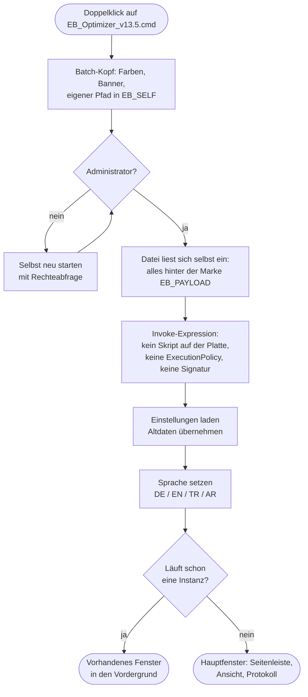
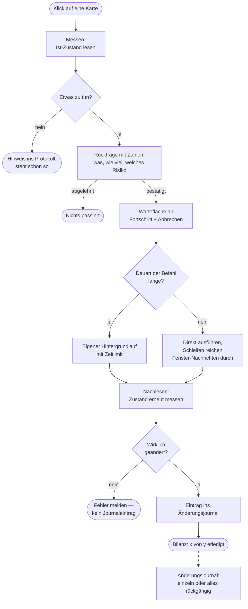
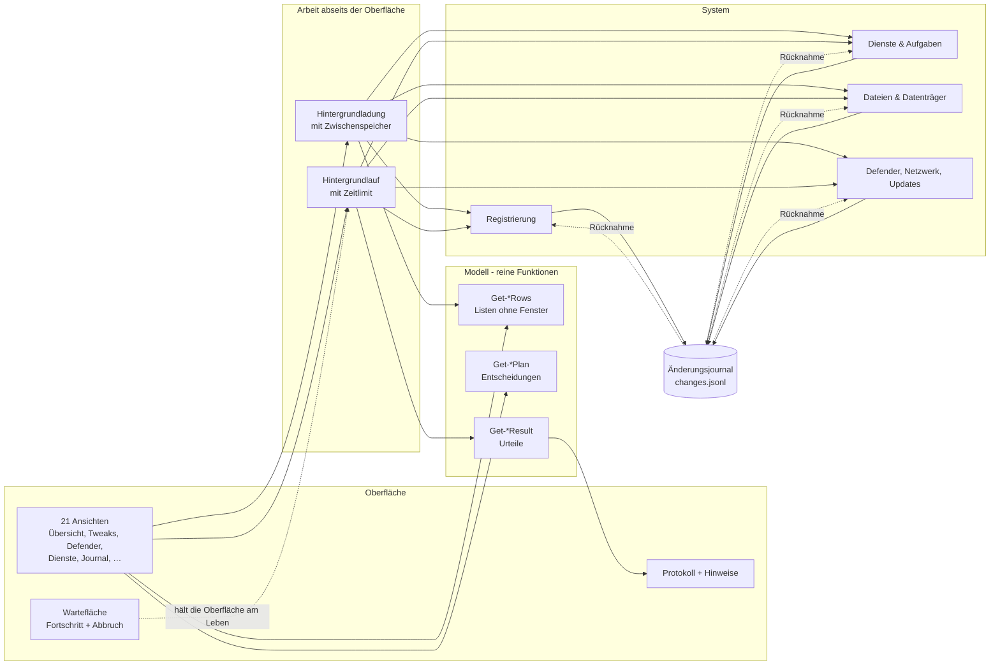

# EB_Optimizer

Windows-Performance-Suite als **eine einzige Datei**: `EB_Optimizer_v13.5.cmd`.

Doppelklick genügt. Keine Installation, keine `.ps1` daneben, keine Signatur,
keine Änderung der ExecutionPolicy — auch nicht unter `AllSigned`.

## Wie das geht

Die Datei ist ein Batch-Starter mit angehängter PowerShell-Nutzlast. Der Starter
liest sich selbst ein und führt den Teil hinter der Marke `#__EB_PAYLOAD__` über
`Invoke-Expression` aus. Damit wird **keine Skriptdatei geladen** — die
ExecutionPolicy greift an dieser Stelle nicht. Fehlende Administratorrechte holt
der Starter selbst über eine Abfrage nach.

## Ablauf beim Start



## Wie eine Aktion abläuft

Jeder Eingriff folgt demselben Muster — das ist der Grund, warum das Fenster
nicht einfriert und warum sich alles zurücknehmen lässt.



## Aufbau des Programms



## Funktionen

| Bereich | Inhalt |
| --- | --- |
| Übersicht | Systemwerte, Gesundheitsbewertung, Schnellaktionen |
| Aufräumen | 9 Ziele (Temp, Logs, Miniaturansichten, Browser, Windows-Update …) mit Messung vor dem Löschen |
| Tweaks | 12 Karten: Dienste, Debloat, Core-Parking, Netzwerk, Eingabe |
| Defender | Ausnahmen anlegen, prüfen, entfernen — mit Rücknahme |
| Dienste · Autostart · Aufgaben · Prozesse | Listen mit Filter, Sortierung, Schutzlisten |
| Datenträger · Netzwerk · Updates | Analyse, DNS-Profile, Update-Pause (1–35 Tage) |
| Registrierung | 4 Aufräumkarten, jede sichert vorher nach `.reg` |
| Änderungsjournal | jeder Eingriff wird aufgezeichnet und lässt sich einzeln zurücknehmen |
| Reparatur | SFC, DISM, CHKDSK, Wiederherstellungspunkte |
| Benchmark | CPU, RAM, Datenträger mit Vergleich zum letzten Lauf |

Oberfläche in **Deutsch, Englisch, Türkisch und Arabisch** (inklusive
Rechts-nach-links-Darstellung).

## Grundsätze im Code

* **Messen → fragen → ausführen → nachlesen → aufzeichnen.** Nichts
  Zerstörendes ohne Rückfrage, nichts gilt als erledigt ohne erneutes Prüfen.
* **Nichts Langsames im Oberflächenstrang.** Lange Aufrufe laufen in einem
  Hintergrundlauf mit Zeitlimit, Fortschritt und Abbruch; lange Schleifen
  reichen Fenster-Nachrichten durch.
* **Modell und Darstellung getrennt.** Listen entstehen aus reinen Funktionen
  (`Get-*Rows`), die sich ohne Fenster prüfen lassen.

## Dateien

```
EB_Optimizer_v13.5.cmd   Das Programm. Mehr wird nicht gebraucht.
.gitattributes           Schützt die Zeilenenden der .cmd vor Git.
```

## Wichtig beim Klonen

`*.cmd` ist in `.gitattributes` von der Zeilenenden-Umwandlung ausgenommen.
Wird die Datei über die GitHub-Weboberfläche bearbeitet oder mit einem Editor
gespeichert, der UTF-8 **mit** BOM schreibt, startet sie nicht mehr.

## Einstellungen

`%APPDATA%\EB_Optimizer\settings.json` · Sicherungen in
`Dokumente\EB_Optimizer_Backups`. Daten einer früheren Version
(`EB_EHAB_Optimizer`) werden beim ersten Start übernommen.

## Systemvoraussetzungen

Windows 10 (Build 10586) oder neuer, Windows PowerShell 5.1 (in Windows
enthalten), Administratorrechte.
